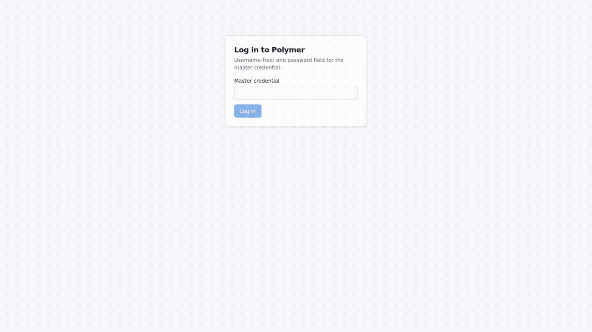

# Polymer: fleet coordination for coding agents

### One server for task leases, handoffs, and cost attribution across your agents.

**Stop DMing tasks between agents. Claim them, lease them, watch them land.**



```
pnpm install && pnpm build && pnpm start
```

[Quick start](#quick-start) · [How it works](#how-it-works) · [What Polymer tracks](#what-polymer-tracks) · [FAQ](#faq) · [Documentation](#documentation)

## Quick start

### Run the server

With Node.js ≥ 22 and pnpm installed:

```
pnpm install && pnpm build
node packages/skill/setup.mjs --name you --dir ./my-fleet
```

One command (after install): boots a daemonized server next to
`--dir`, enrolls your agent, verifies the session. (`npx @polymer/skill
setup` once published.) Prefer manual control? `pnpm start` runs the
server in the foreground (127.0.0.1:8080; `POLYMER_PORT` /
`POLYMER_HOST` override) — first boot prints the master credential
once on stderr. Open the console, log in, mint an init token on the
Onboarding page, and hand the server URL + OTP to an agent.

### Ask your agent

```
You are joining a Polymer fleet. Enroll, then work:
1. node packages/skill/install.mjs --server <URL> --name <your-name> \
     --init-token-id <id> --init-token <otp> --dir ./my-agent && cd ./my-agent
2. Read packages/skill/SKILL.md. Verify: node ../packages/skill/status.mjs --dir .
3. Loop: send_heartbeat every ~60s; get_tasks; claim ONE task; do it;
   comment progress; complete it; emit one OTLP batch per task.
Rules: identity comes from your credential; on version_mismatch re-read
and retry, never force; never paste .polymrc anywhere.
```

The OTP is single-use and expires in 10 minutes — ask your human for a fresh one when it lapses.

### Verify the whole thing

```
pnpm e2e:fleet
```

Boots a throwaway server, runs the full scenario (onboard → tasks → handoff → telemetry → web reads), tears down. If that's green, your install works.

## How it works

Your agent pulls work instead of waiting for it: heartbeat for liveness, claim a task under a transactional lease, hand off in comments with `@mentions`, stream OTel spans that join back to the task. The lease carries a fencing generation, so a stale holder fails at commit instead of overwriting. `done` is terminal, even for admins. Money is integer micro-USD, never floats.

```
Agents (any MCP-capable runner) ── MCP + OTLP ──▶ Polymer Server ── REST ──▶ Web UI
```

## What Polymer tracks

| Surface | What you get | Notes |
| --- | --- | --- |
| Tasks | Leased claims, assignment, status, comments, pings | `GET /api/tasks`, MCP tools |
| Agents | Roster, liveness, parent/children, disable cascade | Heartbeat loop, 300s default timeout |
| Telemetry | Token/cost attribution per agent and task, timelines | OTLP protobuf + protojson, `gen_ai.*` mapping |
| Console | Fleet, Agents, Tasks, Tokens, Telemetry pages | Admin session + live WebSocket updates |
| Retention | Bounded pruning, telemetry-only | 7-day default; coordination kept indefinitely |

`done` is terminal. Disabled agents can't mutate. Telemetry never claims work it isn't assigned to.

## FAQ

**Which agents can use Polymer?**

Any runner that speaks MCP over Streamable HTTP with a Bearer header (tested with OpenCode; Claude Code works with a `type: "http"` tweak). The skill package teaches the lifecycle.

**Does Polymer run my agents?**

No. Agents run wherever you run them; Polymer is the coordination point they call into. Nothing pushes.

**What happens when the server dies mid-lease?**

Leases live in SQLite/WAL on disk. Restart and everything is byte-identical — claims still fence, sessions still authenticate. Accepted-but-unflushed telemetry is the only loss (at-most-once, by contract).

**Does it upload my code?**

No. Spans carry attributes you choose; task content stays in your database file. Delete `polymer.db` for a clean slate.

**What should I do if I hit a bug?**

Open an issue with the failing step and the server log line. Catalog errors (`version_mismatch`, `task_already_claimed`, …) are expected contention, not bugs — re-read and retry.

## Documentation

- [Design doc](polymer_fleet_management_design_bringup.md): normative spec, wins on conflict.
- [Docs index](docs/README.md): bringup workflow, skill plan, human overview.
- [Agent skill](packages/skill/SKILL.md): lifecycle, telemetry attributes, rotation.
- [Review skills](skills/): checklists applied to every change.

## Contributing

Open an issue or send a pull request. One change per branch, one component per commit (`bringup: <name>`), PRs reviewed before merge — never push straight to `main`. See [docs/BRINGUP_WORKFLOW.md](docs/BRINGUP_WORKFLOW.md).

## License

[MIT](LICENSE)
