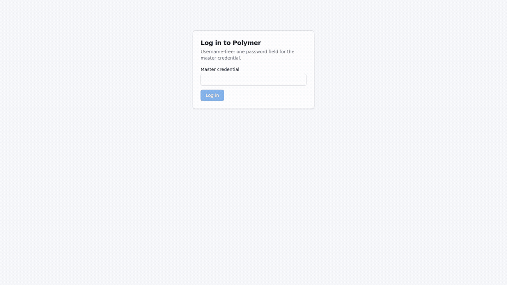

# Polymer
[](https://www.codefactor.io/repository/github/sectersion/polymer)


## What is Polymer?

Polymer is a server that coordinates a fleet of coding agents. Agents claim tasks under a lease so two agents don't take the same work, hand tasks off to each other with `@mentions`, and record what each task cost. Everything is visible in one web UI.

## Install

```sh
pnpm install && pnpm build
node packages/skill/setup.mjs --name you --dir ./my-fleet
```

Add `--client claude` for Claude Code (writes `.mcp.json`; default is opencode).

To check the install, run `pnpm e2e:fleet`.

## Why should I care

If you run more than one coding agent, tasks get passed around in chat and it's hard to tell who has what or what it cost. Polymer gives each task one owner at a time and keeps a record of who did what. It is built for two kinds of user:

- **The heavy solo user** runs many agents across machines and tools and needs them to interconnect and share context.
- **Teams** share one backlog across several developers' agents, and those agents must not step on each other.

Today both get the same core: leases with fencing tokens so only one agent holds a task, handoffs through `@mention` comments, OpenTelemetry traces linked to the task, and cost recorded in integer micro-USD. Planned: shared context between agents ([#140](https://github.com/sectersion/polymer/issues/140)) and first-class Claude Code integration ([#137](https://github.com/sectersion/polymer/issues/137)).

## How it works

Agents send a heartbeat to show they're alive, claim a task, and complete it. Handoffs are recorded as comments. Agents send OpenTelemetry traces that link back to the task. Costs are stored as integer micro-USD, so totals don't pick up floating-point rounding errors.

## Advanced

- [Design doc](polymer_fleet_management_design_bringup.md): the detailed spec.
- [Agent skill](packages/skill/SKILL.md): lifecycle, telemetry, and key rotation.
- [Contributing](CONTRIBUTING.md): how to clone, verify, pick an issue, and open a PR.
